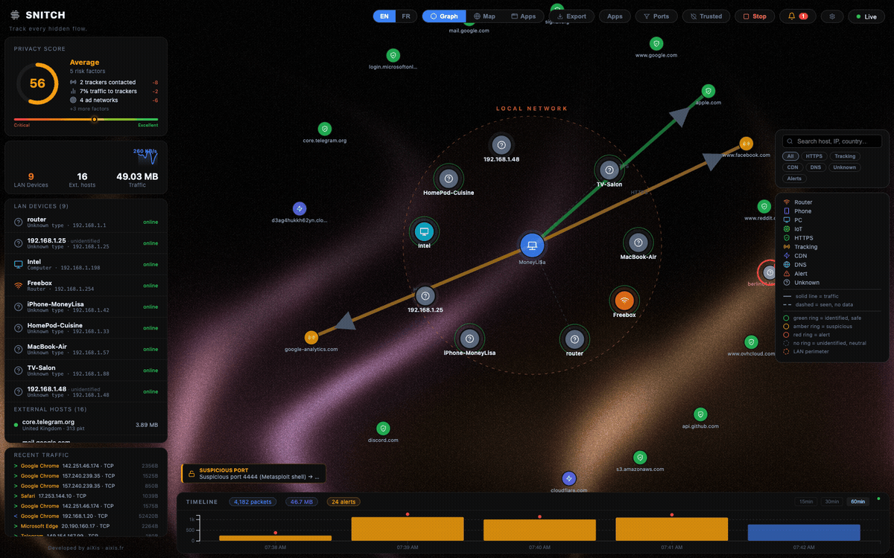

<div align="center">

# Snitch

**追踪每一个隐藏的网络连接。**

[English](README.md#english) | [Français](README.md#français) | [Español](README.es.md) | [Deutsch](README.de.md) | [Русский](README.ru.md) | [日本語](README.ja.md) | [Português](README.pt-BR.md) | **中文**

⭐ **如果 Snitch 对你有帮助，一颗 Star 意义重大！** ⭐

[](LICENSE)
[]()
[]()
[-blue.svg)]()
[](https://github.com/aixisstudio/Snitch/releases/latest)
[](https://github.com/aixisstudio/Snitch/stargazers)

<!-- ZH: 演示模式 (SNITCH_DEMO=1) 的实时截图 — 仅为合成流量。 -->


</div>

---

**Snitch** 是一款实时网络流量可视化工具。
看清电脑的每一个连接——连接了谁、对方在哪里、由哪个应用发起。

整个界面提供 **English、Français、Español、Deutsch、Русский、日本語、Português (BR) 和 简体中文**：使用右上角工具栏中的语言选择器切换。

### 为什么选择 Snitch？

- **对比 Little Snitch / Lulu** —— 同样的思路（按应用可视化＋出站阻断规则），但 Snitch 跨平台、免费且开源。阻断通过操作系统原生防火墙（`netsh` / `iptables` / `pf`）编排——Snitch 绝不在用户态做包过滤。
- **对比 GlassWire** —— Snitch 免费、开源（AGPL）、无需账号，且默认**零对外请求**；连地理定位都是离线的。
- **对比 Wireshark** —— Snitch 提供任何人都能读懂的实时高层概览，而不是原始数据包剖析。
- **对比云端监控方案** —— 一切运行在 `127.0.0.1` 并受令牌保护；你的流量数据永远不会离开本机。

### 功能特性

| 功能 | 说明 |
|---|---|
| 力导向图 | 实时节点图——你的机器居中，每个连接是一个节点 |
| 世界地图 | 地理定位的 IP 在可交互地球仪上以动画弧线展示 |
| 15/30/60 分钟时间线 | 本地 SQLite 滑动历史（保留 24 小时） |
| 异常检测 | 标记端口扫描、beaconing（固定间隔 C2）、潜在数据外泄 |
| 高级检测 | DNS 隧道启发式、明文端口、按应用的国家基线偏离 |
| 防火墙编排 | 阻断规则（IP/CIDR/域名/进程/端口）下发到 OS 防火墙——`netsh`/`iptables`/`pf`，持久化，按规则计数被拦次数 |
| Lockdown 模式 | 应急开关——标记并阻断所有出站公网流量，局域网保持可用 |
| 事件响应 | 结束/挂起进程、阻断 IP——从连接详情一键操作 |
| 威胁情报 | **选择性开启**的信誉查询（AbuseIPDB / AlienVault OTX / VirusTotal），使用你自己的 API 密钥——默认关闭，结果本地缓存 |
| 安全审计 | 内置加固报告——评分、发现项、通俗语言建议 |
| 取证导出 | 一键调查包——进程树＋二进制 SHA-256、历史与关联告警（JSON/CSV/STIX） |
| Webhook 告警 | **选择性开启**将 warning/critical 告警实时转发到 Discord、Slack、Telegram 或任意端点 |
| 进程归属 | 知道哪个应用产生了哪份流量（每个连接 Top 5） |
| LAN 扫描器 | 通过系统 ARP 表被动发现（无广播扫描） |
| 隐私评分 | 出站流量暴露度的实时评分 |
| 按应用视图 | 按进程展示目的地、流量与 60 分钟历史 |
| 告警抑制 | 持久化的「忽略主机/类型」规则，可在 UI 中管理 |
| 设置面板 | 语言、保留期、过滤器、需同意的 GeoIP 下载、诊断 |
| 跟踪器检测 | 后缀匹配域名列表，以可编辑数据文件提供（`backend/classifier/lists/`） |
| 带宽监控 | 实时 MB/s 迷你曲线 |
| 8 语言 UI | EN · FR · ES · DE · RU · JA · PT-BR · ZH-CN——一键切换，语言包位于 `frontend/src/locales/` |
| 浅色/深色主题 | 默认跟随系统，手动切换会被记住 |
| 自动更新 | 桌面应用检查 GitHub Releases（可在设置中关闭；`SNITCH_NO_UPDATE=1`） |
| QUIC / HTTP/3 | UDP/443 流如实标注——QUIC 的 SNI 已加密，绝不读取 |
| 监视列表 | 固定 IP/域名——流量一旦触碰立即发出专属告警 |
| 上传峰值告警 | 按进程 MB/分钟上限，阈值可调 |
| 网卡选择器 | 选择监听哪块网卡——无需环境变量 |
| Wi-Fi 上下文 | 当前 SSID 显示在工具栏 |
| 导出 | 图＋告警一键导出 JSON/CSV |

### 下载

| 平台 | 安装包 |
|---|---|
| **macOS (Apple Silicon)** | `brew install --cask aixisstudio/tap/snitch` —— 或从[最新发布](https://github.com/aixisstudio/Snitch/releases/latest)获取 **Snitch.app** zip/dmg |
| **Linux** | 从[最新发布](https://github.com/aixisstudio/Snitch/releases/latest)获取 **Snitch AppImage / .deb / .rpm / .snap** —— 或 `sudo docker compose up --build`，见 [Docker (Linux)](#docker-linux) |
| **无头模式（任意 OS）** | `brew install aixisstudio/tap/snitch` → `snitchd` 守护进程（服务器/虚拟机，无 GUI） |
| **Windows** | **Snitch Setup** `.exe` —— 一键 NSIS 安装器（原生应用，启动时 UAC 提示，内置 Npcap 检查），来自[最新发布](https://github.com/aixisstudio/Snitch/releases/latest)。轻量替代：`Snitch-Lite-Setup`（后端＋浏览器 UI）。需要 [Npcap](https://npcap.com/) |
| **全部（一键）** | [Pinokio](https://pinokio.co/apps/github-com-aixisstudio-snitch) —— 安装依赖、启动后端、打开 UI |

或直接下载最新发布：**[github.com/aixisstudio/Snitch/releases](https://github.com/aixisstudio/Snitch/releases)**

> **macOS 首次运行** —— Snitch 采用 ad-hoc 签名、未经公证（没有付费 Apple Developer ID）。`brew install --cask` 会自动移除隔离标记。手动 zip：右键 → **打开**，或运行 `xattr -dr com.apple.quarantine /Applications/Snitch.app`。首次启动会**一次性**要求管理员密码——抓包需要权限，与 tcpdump/Wireshark 相同；UI 本身保持非特权。
>
> **Windows 代码签名** —— Windows 构建将使用 [SignPath Foundation](https://signpath.org) 通过 [SignPath.io](https://signpath.io) 提供的免费开源证书进行 Authenticode 签名（已提交申请，待批准）。在首个签名版本发布前，SmartScreen 可能仍会警告——点击**更多信息 → 仍要运行**。

### 技术栈

| 层次 | 技术 |
|---|---|
| 数据包捕获 | ctypes → libpcap —— Npcap (Windows) / libpcap (Linux/macOS) —— 自研解析器（IPv4/IPv6/TCP/UDP/DNS/TLS-SNI） |
| 后端 API | FastAPI —— WebSockets —— SQLite |
| 前端 | React 19 —— Vite —— D3.js v7 —— TopoJSON |
| 桌面封装 | Electron 44 |
| 地理定位 | **仅离线** —— DB-IP Lite (CC BY 4.0) 以 gzip 随附于 `backend/data/geo/`，首次运行自动解压；同时支持 MaxMind GeoLite2 `.mmdb` |

### 安全与隐私

- **API 令牌** —— 每个 REST 端点和 WebSocket 都要求令牌。Electron 每次启动生成；Docker/浏览器模式下在后端日志中打印一次并保存到 `data/api_token.txt`。通过 `http://localhost:8000/?token=<令牌>` 打开 UI。
- **默认仅回环** —— API 在所有模式下绑定 `127.0.0.1`。只有明确需要 LAN 访问时才设置 `SNITCH_BIND=0.0.0.0`（令牌仍然必需）。
- **CORS/WebSocket Origin 白名单** —— 仅 `localhost:5173`、后端自身来源和 Electron `file://` 页面可以连接。
- **地理定位 100% 离线** —— *没有任何*在线查询。DB-IP Lite（[CC BY 4.0](https://db-ip.com/db/lite.php)）自动解压到 `<data_dir>/geo/`；你也可以放入更新的 `.mmdb` 或在设置中下载 DB-IP Lite（明确同意；其他可选出站调用——威胁情报、webhook、更新检查——见 [PRIVACY.md](PRIVACY.md)）。
- **所有数据留在本地** —— `snitch.db`（24 小时滑动窗口，`retention_hours` 可调）和 `data/logs/snitch.log` 永不离开本机。无遥测。每一个出站调用都需要你选择开启。
- **设置持久化** —— 端口过滤、排除进程、IP 白名单、防火墙规则、语言和保留期存入 SQLite 并在重启后恢复。
- **防火墙规则尽力而为** —— 后端驱动 OS 防火墙（`netsh advfirewall`、`iptables`、`pf` 锚点）；权限不足时规则保留并用于*可见性*匹配（BLOCKED_ATTEMPT 告警），如实标记「未应用」而非假装生效。Lockdown 保留回环＋LAN，UI 依然可达。
- **威胁情报与 webhook 为可选** —— 默认关闭；启用提供商或 webhook 会产生出站调用，已在 [PRIVACY.md](PRIVACY.md) 中说明。
- **告警抑制** —— 每条告警可「忽略此类型/此主机」；规则持久化（`alert_suppressions`），通过 `POST|DELETE|GET /alerts/ignore` 管理。
- **历史** —— 按分钟的按主机/按进程字节与包聚保存在 SQLite（`host_history`、`process_history`），驱动按应用视图与 `GET /history/*`。
- **诊断** —— `GET /diagnostics` 返回不含机密的运行时 JSON 快照；可在设置面板导出。
- **LAN 设备** 通过系统 ARP 表被动发现——无主动广播扫描。设备名来自设备自身广播：mDNS `*.local`、LLMNR/NetBIOS、DHCP hostname、完整离线 IEEE OUI 厂商表；网关自动识别为路由器。
- 完整威胁模型见 [docs/threat-model.md](docs/threat-model.md)，安全套件见 [docs/FIREWALL.md](docs/FIREWALL.md)。

### Docker (Linux)

Docker 部署面向不想安装 Docker 以外任何东西的 Linux 用户。
通过 `network_mode: host` 抓包——容器能看到宿主机的真实流量。

**预构建镜像** —— 无需克隆或编译：

```bash
sudo docker run --network host --cap-add NET_ADMIN --cap-add NET_RAW \
  -v snitch-data:/app/data ghcr.io/aixisstudio/snitch
```

> **注意：** Mac/Windows 上的 Docker Desktop 运行在 VM 内，无法捕获宿主机流量。这些平台请使用 Electron 应用。

获取 API 令牌（启动时打印一次，或 `cat data/api_token.txt`），然后在浏览器打开 **http://localhost:8000/?token=令牌**。
后台运行：`sudo docker compose up -d --build`

Docker 限制：进程归属仅限容器内进程；LAN 扫描器在某些网络配置下可能不可用。

### 开发

要求：Python 3.11+、Node.js 18+、[Npcap](https://npcap.com/)（仅 Windows）、后端需要管理员终端。

> **演示模式** —— `SNITCH_DEMO=1` 让合成流量走真实管线：无需 root、无需 libpcap、不接触真实包。适合截图与测试。

```bash
cd backend && pip install -r requirements.txt && python run_backend.py
cd frontend && npm install && npm run dev   # http://localhost:5173/?token=令牌
cd electron && npm install && VITE_DEV=1 npx electron .
```

测试：

```bash
cd backend && pip install -r requirements-dev.txt && python -m pytest tests/ -v
cd frontend && npm test
```

### 项目结构

```
snitch/
├── backend/       FastAPI + libpcap 捕获（ctypes，自研解析器）
├── frontend/      React + D3.js UI（8 种语言）
├── electron/      Electron 封装（main、splash、preload）
├── data/          运行时数据（SQLite、geo/ 下的 .mmdb）
└── dist/          编译产物（后端 exe、安装器）
```

---

### 企业版与集群

Snitch 也可以无头模式运行用于 SOC 部署 —— 全部文件驱动且免费：

- **Security-as-Code** —— 一个 `snitch.toml`（或 `$SNITCH_CONFIG`）在启动时覆盖所有设置；通过 Ansible（`deploy/ansible/`）、Puppet、Salt 或 GPO 批量部署集群。
- **Rust 代理** —— 零依赖守护进程（`agent/`）将套接字流式发送到 `POST /ingest/events`，Linux 上通过 `/proc`→PID 归因；`POST /ingest/enroll` 签发一次性 `sagt_…` 令牌（哈希存储、可撤销）。
- **SIEM 原生** —— CEF 或 RFC 3164 syslog、通用 webhook，以及 `GET /forensics/export?format=ecs`（ECS NDJSON），开箱接入 Wazuh、Splunk、Graylog、Loki 和 Elastic。Sigma 导入（`POST /alerts/rules/sigma`）、YARA-L 导出（`GET /alerts/rules/yaral`）。
- **集群视图** —— `GET /remote/fleet` 汇总所有节点的加固审计；Helm chart（`deploy/helm/snitch`）在集群内运行采集器。
- **免费威胁情报源** —— `POST /firewall/blocklist` 导入域名（StevenBlack）和 IP（Blocklist.de、URLhaus/Feodo）列表；`ti_feeds` 调度自动刷新。

详细步骤见 [docs/INTEGRATIONS.md](docs/INTEGRATIONS.md)。

## 许可证

AGPL v3 —— 见 [LICENSE](LICENSE)。可自由使用、学习和修改；衍生作品必须以 AGPL v3 保持开源。

## Star 历史

[](https://star-history.com/#aixisstudio/Snitch&Date)
